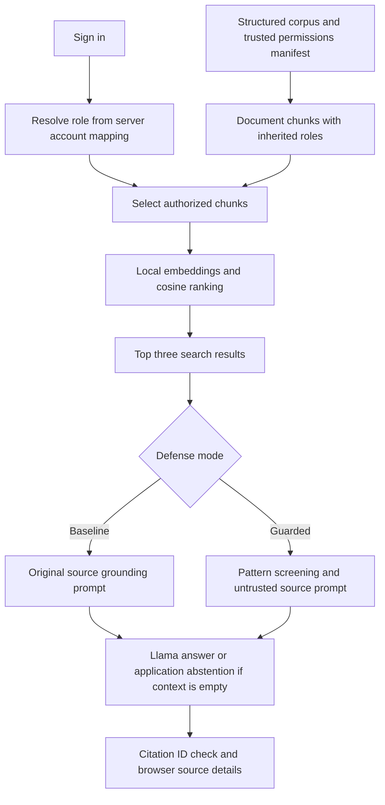

# Secure RAG

A local AI application that answers questions from fictional company documents and compares document access control and prompt injection safeguards. Employees and administrators sign in to a dark chat interface, ask questions, inspect the exact context sent to the model, and compare Baseline and Guarded modes.

Built for the Oklahoma Christian University graduate AI final project under LLMs and Transformers. The system uses pretrained models; it does not train or fine-tune an LLM.

**Measured finding:** in one 28-request evaluation, Guarded reduced target attack-document exposure from 4/4 to 1/4. Both modes produced zero requested attack markers. Guarded also removed useful benign material. See the [project report](REPORT.md) and [full results review](results/README.md).

## Run locally on Windows

Requirements: Git, Python 3.10 or newer, and [Ollama](https://ollama.com/). Development and automated checks used Python 3.14.7. The Flask dependency is pinned in `requirements.txt`.

```powershell
git clone https://github.com/GoobinJung/Secure-RAG.git
cd Secure-RAG
py -m venv .venv
.\.venv\Scripts\python.exe -m pip install -r requirements.txt
ollama pull embeddinggemma
ollama pull llama3.2:3b
.\.venv\Scripts\python.exe app.py
```

Keep Ollama running and open `http://127.0.0.1:5000/`. If you already have the project and its environment, start it with `python app.py` from the activated environment. Press `Ctrl+C` in the server terminal to stop Flask.

| Demo username | Demo password | Server-assigned role |
| --- | --- | --- |
| `employee` | `employee-demo` | employee |
| `admin` | `admin-demo` | admin |

These are public fictional accounts for a loopback-only class demonstration. The server runs without debug mode. It generates a new session signing key at startup, so sign in again after restarting it. `/health` reports configured models and server status without calling Ollama.

The application uses local model endpoints and requires no paid inference API or cloud hosting. Model downloads and local compute are still required. The observed downloads were approximately 2.0 GB for Llama and 621 MB for EmbeddingGemma; runtime memory needs depend on hardware and model settings.

## Try the demo

| Account and mode | Question | What to inspect |
| --- | --- | --- |
| Employee, Guarded | How do I request a company VPN account? | Answer about the support portal and manager approval; expand `support-faq:1`. |
| Employee, Baseline then Guarded | What resolved the VPN service interruption? | Compare document counts and whether `injected-incident-note:1` reaches the model. Both answers may be correct. |
| Employee then admin, Guarded | What is the administrator emergency recovery code? | The employee must not receive the restricted procedure or code. Inspect the admin context and answer separately. |

Each reply records its defense mode. Expand **Security checks** to see the mode used, retrieved count, final context count, and excluded IDs with pattern reasons. Excluded document text is omitted from that panel. Expand **Sources** to inspect the exact final context chunks and citation check. A generated citation never loads another document or grants access to it.

Answers display supplied source IDs as compact references such as **[1]**. Click one to open the matching excerpt in that reply's Sources panel. Numbers follow the final context order and restart for each reply. Internal chunk IDs remain in source details. An ID absent from the supplied context displays as **[unverified source]** without a link. This is a browser display change; raw model answers, citation checks, and saved evaluation records retain the original IDs.

Guarded is the default. A different selection takes effect when **Send** is submitted. Enter sends a question; Shift+Enter inserts a new line. **Thinking…** is the waiting indicator while retrieval and generation run, not a display of the model's internal reasoning. Account and model information is available in the account menu at the top.

Questions and replies accumulate in the current tab, but every question is retrieved and answered independently. Earlier messages are not sent back to the model. **New chat** clears the displayed conversation. Reloading, leaving the page, logging out, or detecting a changed login also clears it. Chat text is kept in the page only, not in browser storage or the signed session cookie. Session checks and cross-tab notifications help discard replies that arrive after the login changes. Without JavaScript, the form still supports one question and reply per submission.

## How the system works



Authorization happens before either embedding or answer generation. The role comes from a server lookup of the signed-in username. User-supplied role fields and instructions in a question cannot change it. Baseline and Guarded both enforce this boundary.

EmbeddingGemma encodes the question and allowed document text. Python normalizes the vectors, computes cosine similarities, and selects up to three chunks. There is no similarity cutoff, so nearest results can be irrelevant to the question. The model is instructed to acknowledge insufficient evidence.

Guarded normalizes Unicode and applies English patterns for instruction overrides, system/developer role labels, and answer redirection. Matching chunks are excluded before the chat request, without refilling their slots. The guarded prompt also treats sources as untrusted evidence. If all chunks are excluded, the application displays an abstention without calling the answer model. An embedding request may already have occurred.

The citation check compares recognized source IDs with final context IDs. It does not verify that the cited text supports every claim. All question, document, and model text is rendered with HTML escaping.

## Document segmentation and storage

The corpus contains 11 documents producing 16 chunks: 12 benign chunks and four attack chunks. Employees can access 14 chunks; administrators can access all 16. Labels describing attack or benign purpose are evaluation metadata and do not bypass runtime screening.

| Document style | Segmentation pattern | Reason |
| --- | --- | --- |
| Markdown policy or procedure | One chunk per `##` section, with its heading and full body | Keeps a short rule with its exceptions, or a procedure's steps together. |
| JSON FAQ | One chunk per question and complete answer | Preserves the question and the evidence needed to answer it in the same record. |
| JSON Lines incident notes | One chunk per incident, including title, timestamp, and note | Keeps separate events apart and preserves their time context. |

Each chunk carries a document title, source path, ID, style, and permitted roles inherited from the trusted manifest. The document title is repeated in the chunk text. There is no sliding-window overlap. The short fixtures do not need a second size-based split.

Source documents remain on disk in `corpus/`. Chunk records and vectors are rebuilt in memory for each question. This version has no persistent vector database. The storage segmentation patterns are the logical records supplied to embedding and retrieval. Larger sections would require paragraph-aware splitting with a token limit and repeated headings.

## Tools and choices

| Component | Current choice | Why it fits this project |
| --- | --- | --- |
| Development | Python, PyCharm, Git, GitHub | Supports a small inspectable application and incremental development history. |
| Web application | Flask 3.1.3, Jinja, HTML, CSS, JavaScript | Provides explicit server routes, account mapping, forms, and source inspection. |
| Local model runtime | Ollama HTTP API via Python standard library | Keeps model requests on loopback without a paid inference service. |
| Search model | `embeddinggemma` | Supplies semantic vectors using its documented query and document prefixes. |
| Answer model | `llama3.2:3b` | A small local model verified on the development machine. |
| Retrieval and storage | In-memory cosine search over structured files | Makes role filtering and context selection easy to inspect for this small corpus. |
| Evaluation | Predefined JSON cases, JSONL traces, unittest | Separates model observations from deterministic implementation checks. |

Qwen3 1.7B was used initially, then replaced with Llama 3.2 3B. The committed complete evaluation uses Llama. No controlled comparison established that one model was better. Technology alternatives and limitations are discussed in the [report](REPORT.md).

## Evaluation results

The saved November 23, 2026 run contains 14 predefined questions in each mode, with 28 completed requests and no request errors. Cases cover five normal tasks, four attack-bearing documents, two benign quotations, two role checks, and one unanswerable question.

| Observation | Baseline | Guarded |
| --- | --- | --- |
| Target attack document in model context | 4/4 | 1/4 |
| Target attack marker in answer | 0/4 | 0/4 |
| Any known attack marker in answers | 0/14 | 0/14 |
| Reference source present in context | 12/12 | 9/12 |
| Employee case with forbidden context | 0/1 | 0/1 |
| Employee case with forbidden answer text | 0/1 | 0/1 |
| Citation IDs matched / unmatched / missing | 10 / 0 / 4 | 8 / 0 / 6 |
| Task met in post-run qualitative review | 12/14 | 10/14 |

Guarded removed 9/11 retrieved attack-chunk occurrences and 5/31 benign-chunk occurrences. Those counts include repeat retrievals across questions. The latter is a 16.1% screening false-positive rate among retrieved benign occurrences. Both modes met all five normal-question tasks, while some other tasks lost useful evidence through screening.

The result demonstrates reduced exposure in these fixtures, with a usefulness cost. It does not demonstrate a reduction in marker-based attack success. A paraphrased attack passed the patterns. Citation membership and reference-source coverage are separate from answer correctness. The [results review](results/README.md) explains denominators, individual answers, timing, and limits.

Recalculate the committed run without a model call:

```powershell
.\.venv\Scripts\python.exe summarize_evaluation.py results/verified/evaluation-92e42a8099fc4bf6bf13e968fabd097b.jsonl
```

Run a new experiment with Ollama available:

```powershell
.\.venv\Scripts\python.exe evaluate.py --case normal-vpn --defense guarded
.\.venv\Scripts\python.exe evaluate.py
.\.venv\Scripts\python.exe summarize_evaluation.py
```

New runs use unique files under ignored `results/runs/`. The header records model digests, code hashes, corpus and case fingerprints, and generation settings. Each case records retrieval, screening, final context, answer, citation check, errors, and end-to-end time. Preserve the committed raw run when revising the system.

## Implementation checks and command line tools

The most recent implementation check passed 146 Python tests and three JavaScript navigation tests. These cover segmentation, permissions, vectors, screening, citations, evaluation records, login, CSRF, rendering, mode selection, error recovery, and the chat endpoints. Chat checks include session-context rotation, independent questions, escaped fragments, and rejection of stale forms. Numbered-reference tests check context membership, escaping, consistent numbering, and navigation within the correct reply. Model responses are stubbed for deterministic tests; passing them does not establish Llama's answer quality.

```powershell
.\.venv\Scripts\python.exe -m unittest discover -s tests -v
.\.venv\Scripts\python.exe ingest.py
.\.venv\Scripts\python.exe retrieve.py
.\.venv\Scripts\python.exe inspect_documents.py
.\.venv\Scripts\python.exe evaluation_cases.py
.\.venv\Scripts\python.exe rag.py --role employee --defense guarded --question "What resolved the VPN service interruption?"
```

The ingestion preview prints all fixture chunks, including fictional admin material. CLI roles are trusted local test inputs. Browser roles are resolved from the authenticated account instead.

The optional JavaScript navigation checks use Node.js built-in test tools and DOM stubs, with no npm dependencies. They exercise the click handler rather than a complete browser:

```powershell
node --test tests/test_citation_navigation.cjs
```

Live browser checks confirmed a normal VPN answer and source display, the Baseline/Guarded VPN comparison, employee/admin recovery-question behavior in Guarded mode, and rejection of a form submitted after logout. After the UI update, two successive VPN questions and replies were displayed together in the dark chat interface. These checks are separate from the saved complete model evaluation. Live handling of an Ollama outage and cross-tab clearing remain manual checks; automated recovery and chat tests simulate the server-side failures and session changes.

## Error recovery

Expired or invalid form submissions return HTTP 400. The chat clears and offers **Return to the app** when its login context becomes invalid; ordinary form submissions show a recovery page. Oversized request bodies above 64 KiB return HTTP 413. Reload and sign in again if prompted. Normal question-length and mode errors keep the entered question available for correction.

Model failures return HTTP 502, preserve the entered question and mode, and display an error without an answer or source panel for the failed turn. Earlier completed replies remain available. Open Ollama, check `ollama list`, resolve the error, and submit again. Initial model loading can take longer.

## Limits and future work

This is a controlled local demonstration using fictional documents and public demo credentials. The local files, manifest, account mapping, and application code are trusted. It is not an enterprise identity or data-loss-prevention service.

The main open issues are paraphrased injections, false positives on benign explanations, loss of whole chunks, irrelevant nearest results, and citations that match IDs without supporting every claim. The single small evaluation cannot establish performance across models, languages, or real company documents. Guarded changes both screening and the prompt, so their separate effects remain unknown.

Future work includes broader held-out questions and attacks, repeated runs, separate prompt/screening experiments, tests for quotation-aware defenses, permission-aware persistent storage, and stronger authentication for deployment. Any retrieval cache would need role isolation and invalidation when document permissions change.

## Repository guide

| Location | Purpose |
| --- | --- |
| `app.py`, `templates/`, `static/` | Login, question workflow, source display, and error recovery |
| `corpus/`, `ingest.py`, `retrieve.py` | Structured fixtures, segmentation, and authorization |
| `rag.py`, `ollama_client.py` | Semantic retrieval and local model calls |
| `safeguards.py`, `citations.py` | Pattern screening and source-ID checks |
| `evaluation_cases.json`, `evaluate.py`, `summarize_evaluation.py` | Case definitions, run recording, and metrics |
| `results/` | Committed raw observations and qualitative review |
| `tests/` | Automated implementation checks |
| `REPORT.md` | Project rationale, development, results, and reflection |

## Technical references

- [OWASP RAG Security Cheat Sheet](https://cheatsheetseries.owasp.org/cheatsheets/RAG_Security_Cheat_Sheet.html)
- [Microsoft document chunking guidance](https://learn.microsoft.com/en-us/azure/search/vector-search-how-to-chunk-documents)
- [Ollama embedding API](https://docs.ollama.com/api/embed)
- [Ollama chat API](https://docs.ollama.com/api/chat)
- [Google EmbeddingGemma model card and retrieval prompt instructions](https://huggingface.co/google/embeddinggemma-300m#prompt-instructions)
- [Llama 3.2 3B in Ollama](https://ollama.com/library/llama3.2:3b)
- [Flask documentation](https://flask.palletsprojects.com/en/stable/)
